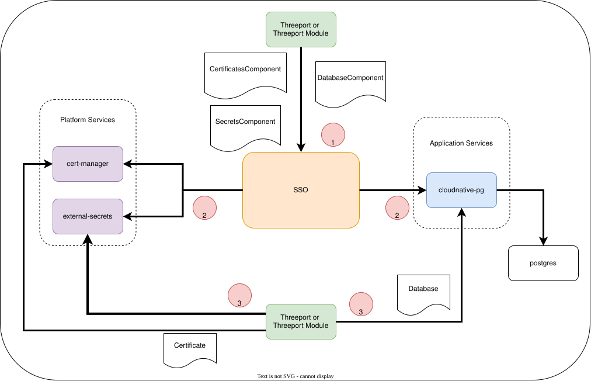

# Support Services Operator

Threeport is an application lifecycle orchestration engine.  Part of that job is
workload dependency management: in addition to deploying a workload's own
containers, Threeport - or a [Threeport module](../docs/sdk/sdk-intro.md) built
on top of it - often needs to fulfill dependencies for that workload by using
some other Kubernetes controller or operator.

The Support Services Operator (SSO) is the Kubernetes operator that makes those
controllers and operators available in a cluster.  SSO exists so that
Threeport and its modules have a common way to request commonly used platform
and application services without each one installing and managing its own
copy.  The preferred pattern is for Threeport and its modules to ask SSO to
deploy a *capability*, and let SSO take care of getting the corresponding
controller or operator running.

That said, SSO is not the only way to meet a workload dependency. If a
module's controller has a requirement SSO doesn't serve, the module is free to
deploy and manage whatever specialized service meets that requirement itself -
even using an SSO-like abstraction of its own, if that fits the use case.
That decision is left to the discretion of the module's developer.

## Capabilities

A capability is some Kubernetes controller or operator that manages a
particular concern on behalf of workloads.  SSO supports two categories of
capability.

### Platform Services

Platform services serve basic functions that most workloads need.  They are
not part of any particular application - they provide a service to any
workload in the cluster that needs it.

Examples:

* **[cert-manager](https://github.com/cert-manager/cert-manager)** - provisions and rotates TLS certificates.
* **[external-secrets](https://github.com/external-secrets/external-secrets)** - exposes secrets from a vault into the cluster.
* **[external-dns](https://github.com/kubernetes-sigs/external-dns)** - manages DNS records for workloads.

### Application Services

Application services are deployed as part of an application stack itself.
They provide workload components - not functions shared across the
cluster, but running pieces of the application's own stack.

Example:

* **[cloudnative-pg](https://github.com/cloudnative-pg/cloudnative-pg)** - provides instances of PostgreSQL for workloads that need
  a Postgres database.

  Note: at the time of writing, SSO still implements the database capability
  with the [Zalando Postgres
  Operator](https://github.com/zalando/postgres-operator). A migration to
  cloudnative-pg is underway, and this document
  describes that target state.

Other application services (Redis, etc.) are expected to follow the same
pattern.

Both categories of capability are built from manifests maintained in sibling
repositories - [platform-component-library](https://github.com/lander2k2/platform-component-library)
for platform services and
[application-component-library](https://github.com/lander2k2/application-component-library)
for application services. SSO itself is generated with [Operator
Builder](https://github.com/nukleros/operator-builder) from those component
manifests.

## How Threeport Uses SSO

Each capability SSO can deploy is represented by its own `*Component` custom
resource:

* Platform services (group `platform.addons.nukleros.io`): `CertificatesComponent`,
  `SecretsComponent`, `IngressComponent`.
* Application services (group `application.addons.nukleros.io`): `DatabaseComponent`.

When Threeport, or a Threeport module, needs a workload dependency that SSO
manages, it goes through the same three-step flow regardless of which
capability is involved:

1. **Request the capability.** Threeport or the module creates the relevant
   `*Component` custom resource (if it doesn't already exist) - for example a
   `CertificatesComponent`, a `SecretsComponent`, or a `DatabaseComponent`.
2. **SSO deploys the capability.** SSO reconciles that custom resource by
   installing the controller or operator responsible for it - cert-manager,
   external-secrets, or cloudnative-pg in the examples above.
3. **Activate the capability for the workload.** Once the controller or
   operator is running, Threeport or the module creates the resources that
   instruct it what to do for the specific workload being deployed - for
   example a cert-manager `Certificate`, or a cloudnative-pg `Database`. (Some
   controllers react to labels or annotations instead of a dedicated custom
   resource, but the role this step plays is the same: it activates the
   capability for a particular workload.)

The first two steps only need to happen once per cluster - SSO is idempotent,
so requesting a capability that's already deployed is a no-op. The third step
happens per-workload, every time a workload is deployed that needs that
capability.

In the diagram, the two capabilities on the left (cert-manager and
external-secrets) are platform services, and the capability on the right
(cloudnative-pg) is an application service. Both categories follow the
identical three-step pattern - the only difference is whether the resulting
controller serves the whole cluster or provisions a component (here, a
`postgres` instance) that belongs to one application's stack.

## Why This Separation?

Splitting "request the capability" from "activate the capability" keeps
Threeport's controllers from needing to know how to install cert-manager,
external-secrets, or cloudnative-pg themselves. A Threeport controller or
module only needs to know how to create the small number of custom resources
relevant to its own concern, and SSO owns the operational complexity of
getting the right controller running and keeping it up to date.

It also means a capability is only ever installed once per cluster, no matter
how many different Threeport controllers or modules end up depending on it.
If both Threeport core and a module need TLS certificates, they both create
`Certificate` resources, but only one `CertificatesComponent` need ever exist.
